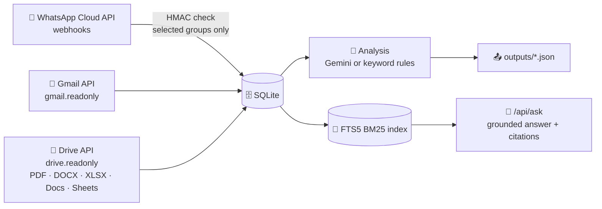

<div align="center">

<picture>
  <source media="(prefers-color-scheme: dark)" srcset="docs/brand/unsilo-logo-dark.png">
  <source media="(prefers-color-scheme: light)" srcset="docs/brand/unsilo-logo-light.png">
  
</picture>

### Ask your WhatsApp, Gmail and Drive anything. Every answer shows its receipts. 🧾

<p>
  
  
  
  
</p>
<p>
  
  
  
  
</p>

[✨ Features](#-features) •
[📸 Screenshots](#-screenshots) •
[🚀 Quick start](#-quick-start) •
[🔌 Connect sources](#-connect-your-sources) •
[🧠 How it works](#-how-it-works) •
[📡 API](#-api)

</div>

---

## 🤔 The problem

A company's knowledge is stuck in **three silos**: deals on WhatsApp, quotes in Gmail, reports in Drive. Finding "what did we agree with Shree Constructions?" means opening three apps and scrolling forever.

## 💡 The fix

**Unsilo** connects all three through their **official, read-only APIs**, makes sense of each one, and lets anyone ask plain-English questions across everything.

> 🧾 **No receipts, no answer.** Every answer cites the exact email, document or WhatsApp message it came from. If the data doesn't have it, Unsilo says *"not in the data"* instead of guessing.

---

## ✨ Features

| | Feature | What it does |
|:-:|---|---|
| 🔎 | **Ask anything** | One search box across WhatsApp, Gmail and Drive, with numbered citations `[S1] [S2]…` |
| 📅 | **Date-aware search** | Understands "last month", "this week" and more, using a fixed reference date |
| 📧 | **Gmail triage** | Labels each email **sales / marketing / other**, flags **no reply for 5+ days**, spots **business-critical attachments** |
| 📁 | **Drive classifier** | Sorts docs into **sales / marketing / verification / office / accounts** with a one-line reason |
| 💬 | **WhatsApp brain** | Per-group summary, asks, commitments, decisions and action items with owners |
| 📤 | **One-click export** | Writes `whatsapp_output.json`, `gmail_output.json`, `drive_output.json` |
| 🛡️ | **Works without AI** | No Gemini key? Keyword rules take over, so the pipeline never breaks |
| 🔒 | **Privacy first** | Read-only scopes, HMAC-checked webhooks, non-selected groups dropped before storage |

---

## 📸 Screenshots

<div align="center">

### 🔎 Ask: answers with receipts


<br><br>

<table>
  <tr>
    <td align="center" width="50%"><b>🔌 Sources</b><br></td>
    <td align="center" width="50%"><b>📧 Gmail triage</b><br></td>
  </tr>
  <tr>
    <td align="center"><b>📁 Drive categories</b><br></td>
    <td align="center"><b>💬 WhatsApp insights</b><br></td>
  </tr>
  <tr>
    <td align="center" colspan="2"><b>📤 Outputs</b><br></td>
  </tr>
</table>

<sub>Screenshots use synthetic demo data from <code>fixtures/</code>, running in keyword-rules mode (no AI key).</sub>

</div>

---

## 🚀 Quick start

> **Needs:** Python 3.11+

```bash
# 1. clone + enter
git clone <your-repo-url> unsilo && cd unsilo

# 2. virtual env
python -m venv .venv
source .venv/bin/activate          # Windows: .venv\Scripts\Activate.ps1

# 3. install
pip install -r requirements.txt

# 4. config
cp .env.example .env               # fill in the values (see below)

# 5. run 🚀
cd src
uvicorn app.main:app --reload --port 8000
```

Open 👉 **http://localhost:8000**

UI and API run on the **same port**, so there is no separate frontend build. ⚡

---

## 🔌 Connect your sources

| Source | Set in `.env` | Then |
|---|---|---|
|  **Gmail + Drive** (OAuth) | `GOOGLE_CLIENT_ID`, `GOOGLE_CLIENT_SECRET`, `SANDBOX_EMAIL`<br>Redirect URI: `http://localhost:8000/api/oauth/google/callback` | **Sources → Connect Google**, sign in, then **Sync Gmail / Sync Drive** |
|  **Drive** (no OAuth) | `DRIVE_API_KEY` + `DRIVE_FOLDER_ID` of a folder shared as "Anyone with the link" | **Sync Drive** |
|  **WhatsApp** | `WHATSAPP_VERIFY_TOKEN`, `META_APP_SECRET`; group ids or names in `config/selected_groups.json` | `cloudflared tunnel --url http://localhost:8000`, give Meta `https://<tunnel>/api/webhooks/whatsapp` + the verify token |
|  **AI answers** | `GEMINI_API_KEY` *(optional)* | Without it, labels use keyword rules and answers list the top cited records |
| 📅 **Dates** | `REFERENCE_DATE=YYYY-MM-DD` | Used for "unanswered 5+ days" and "last month" |

<details>
<summary>💡 <b>Common gotchas</b></summary>

- A Google API key (`AIza…`) **cannot** read Gmail. Google only accepts OAuth for mailboxes.
- Opening the webhook URL in a browser returns **403**. That's expected: only Meta's request carries the verify token.
- Changed `.env`? Restart the server.

</details>

---

## 🧠 How it works



### 🧾 How answers stay honest

1. 🔎 Date-aware **BM25 search** picks the most relevant records.
2. 🏷️ The model only sees those records, numbered `[S1]…[Sn]`, and must cite them.
3. ✂️ Any citation the model wasn't shown is **dropped by code**.
4. 🚫 Zero valid citations means *"I don't know, that is not in the data."*

---

## 📂 Project structure

```
unsilo/
├── 📁 src/app/
│   ├── ⚙️  settings.py     # every setting from .env + the two allowed Google scopes
│   ├── 🗄️  db.py           # SQLite tables + FTS5 search index
│   ├── 💬 whatsapp.py      # webhook signature check, group filter, storage
│   ├── 🔐 google.py        # OAuth (state + scope check), Gmail & Drive sync
│   ├── 📄 extract.py       # text from PDF, Word, Excel, CSV
│   ├── 🤖 ai.py            # Gemini JSON calls with model fallback
│   ├── 🧠 analyse.py       # email teams, unanswered, attachments, Drive, WhatsApp
│   ├── 🔎 ask.py           # date-aware search + grounded answers
│   ├── 📤 export.py        # the three output files
│   └── 🚀 main.py          # API routes + UI
├── 🎨 web/                 # one-page UI (Ask, Sources, Gmail, Drive, WhatsApp, Outputs)
├── 🧪 tests/               # pytest suite
├── 🧩 fixtures/            # synthetic demo data
├── ⚙️  config/selected_groups.json
├── 📤 outputs/
└── 📋 requirements.txt
```

---

## 📤 Outputs

Click **Outputs → Write outputs/ files** (or `POST /api/export`):

| File | Contains |
|---|---|
| 💬 `whatsapp_output.json` | Selected groups, participants, messages, summary, asks, commitments, decisions, action items |
| 📧 `gmail_output.json` | Team label + reason, unanswered emails (5+ days), business-critical attachments + reason |
| 📁 `drive_output.json` | One category per document + a one-line reason |

---

## 📡 API

| Method | Path | Purpose |
|:-:|---|---|
|  | `/api/health` | AI mode, Google status, counts, reference date |
|  | `/api/oauth/google/start` · `/callback` | Google sign-in |
|  | `/api/sync/gmail` · `/api/sync/drive` | Pull and analyse a source |
|  | `/api/analyse` | Re-run analysis |
|  | `/api/ask` | `{"question": "..."}` → answer, citations, search details |
|  | `/api/outputs/{whatsapp,gmail,drive}` | Output preview |
|  | `/api/export` | Write `outputs/*.json` |
|  | `/api/webhooks/whatsapp` | Meta verification · events |
|  | `/api/whatsapp/groups` | Groups with messages and interpretation |
|  | `/api/whatsapp/participants` | Load participant lists |

Example:

```bash
curl -X POST http://localhost:8000/api/ask \
  -H "Content-Type: application/json" \
  -d '{"question": "What were our sales last month?"}'
```

---

## 🔒 Security & rules

- ✅ Google scopes are **exactly** `gmail.readonly` and `drive.readonly`; the callback rejects anything else.
- ✅ **Read-only everywhere**: no send, delete, label or modify calls.
- ✅ WhatsApp uses **official Cloud API webhooks only**, every POST checked with `X-Hub-Signature-256`.
- ✅ Messages from groups not in `selected_groups.json` are **dropped before storage**; logs hold counts only.
- ✅ Secrets live in `.env` and the Google token in `data/`, both **gitignored**.

---

## 🧪 Tests

```bash
pytest -q
```

---

## 🗺️ Known limitations

- ⚠️ The WhatsApp group-id field depends on the organiser's setup; `whatsapp._group_of()` checks several places.
- ⚠️ Output JSON shapes follow the task text; tweak `export.py` if a schema is shared.
- ⚠️ Keyword-rule labels are rough; set `GEMINI_API_KEY` for the AI path.
- ⚠️ Images and scanned PDFs are not OCR'd yet.

---

## 🤖 AI usage

| Where | Tool | How |
|---|---|---|
| ✍️ Writing code | Claude (Anthropic) | Drafted modules step by step; the team reviewed, ran and tested each part |
| 🧠 Runtime | Google Gemini | Email labels, attachment criticality, Drive categories, WhatsApp summaries, grounded answers |

See [`AI_USAGE.md`](AI_USAGE.md) for the guard rails.

---

## 👥 Team

| Member | Owns |
|---|---|
| 🛠️ **Raj** | Database, pipeline, export, API routes |
| 🔌 **Gaurav** | Connectors (Google OAuth, Gmail, WhatsApp webhook) |
| 🧠 **Aditya** | Extraction, analysis, search, tests |
| 🎨 **Sachin** | Frontend, demo, pitch |

---

<div align="center">

### ⭐ If Unsilo saved you three tabs, drop a star!

Made with ❤️ and way too much ☕ at the hackathon

</div>